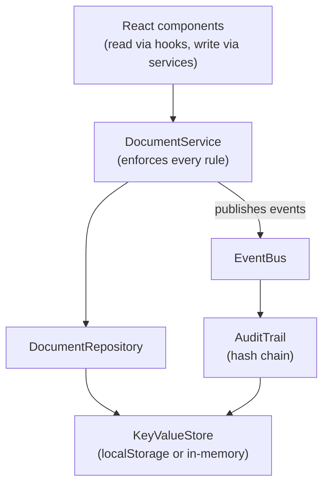

# MiniSign

A small document-signing app in the spirit of DocuSign, built with React, TypeScript and Vite.
A sender places fields on an agreement, fills in and signs their side, and issues it to a
recipient, who completes and signs the rest. Every step is recorded in a tamper-evident,
hash-chained audit trail.

**[Try the live demo](https://jasonmarks22.github.io/doc-signing-app/)**

> **This is a demo, not a real e-signature service.** There is no backend or authentication:
> accounts are simulated, and all data stays in your browser's localStorage. Don't enter real
> personal information or rely on it for actual agreements.

## Contents

- [Features](#features)
- [Getting started](#getting-started)
- [Walkthrough](#walkthrough)
- [How it works](#how-it-works)
- [Project structure](#project-structure)
- [Testing and deployment](#testing-and-deployment)
- [Limitations](#limitations)
- [Further reading](#further-reading)

## Features

**Layout editor**
- Click to place fields on any page, then drag and resize them.
- Set each field's type, label, assignee (sender or recipient) and whether it is required.
- Load a standard 17-field layout for the included Master Agreement in one click.

**Filling and signing**
- Type a signature (rendered in a script font) or draw one on a canvas.
- Signer name and signing date can fill in automatically at the moment of signing.
- Inline validation covers each field type:

| Field type | Rule |
|---|---|
| Text | Up to 500 characters |
| Email | Must look like a valid address |
| Phone | Flexible formatting, 7–15 digits |
| Date | Must be a real calendar date, or auto-filled with the signing date |
| Signature | Typed or drawn |
| Signer name | Always auto-filled from the signer's account |

**Permissions enforced by the service layer**
- Recipients can't see a document until it is sent, and unrelated users never see it.
- Each party can edit only their own fields, and only at their stage of the workflow.
- The layout locks once a document is sent, and everything locks once it is completed.

**Tamper-evident audit trail**
- Records who created, sent, viewed and completed each document, and when.
- Links entries into a per-document SHA-256 hash chain, verified on the document screen.
- Fingerprints the fields and values at sending and completion, so changes made after signing
  are detected.

**Multi-user demo in one browser**
- Switch accounts from the "Acting as" menu in the header.
- Open two tabs as different users and they stay in sync through the browser's `storage` event.
- Documents and the audit trail persist across page refreshes.

## Getting started

You'll need [Node.js](https://nodejs.org/) 20.19+ or 22.12+.

```bash
git clone https://github.com/JasonMarks22/doc-signing-app.git
cd doc-signing-app
npm install
npm run dev
```

Then open <http://localhost:5173>.

| Command | What it does |
|---|---|
| `npm run dev` | Starts the Vite development server |
| `npm test` | Runs the Vitest test suite once |
| `npm run build` | Type-checks and creates a production build in `dist/` |
| `npm run preview` | Serves the production build locally |
| `npm run lint` | Runs oxlint |

## Walkthrough

The app comes with three simulated accounts:

| Account | Company | Role in this walkthrough |
|---|---|---|
| Alex Rivera | Lone Star Fleet Services | Sender |
| Dana Whitfield | Acme Freight Co. | Recipient |
| Sam Okafor | Bluebonnet Logistics | Unrelated user |

1. **As Alex**, select **Create draft**, then **Load standard layout**.
2. Open **2. Fill your fields & send**, click the sender signature field to sign, and enter a
   title.
3. Choose **Dana Whitfield** as the recipient and select **Sign & send**.
4. **Switch to Dana** in the header and open the document.
5. Complete the Customer Information fields, sign, and select **Finish & sign**.
6. **Switch to Sam** to confirm the document isn't visible to that account.
7. **Switch back to Alex or Dana** and check the audit trail on the document screen.

To see tamper detection, open DevTools, edit an entry's `summary` in the
`docsign:audit:v1` localStorage key, and refresh. The audit panel reports the broken entry.

## How it works

### Document lifecycle

| Status | Sender can | Recipient can | Moves on when |
|---|---|---|---|
| `draft` | Edit the layout and fill their own fields | Nothing; the document is hidden | The sender signs and sends |
| `sent` | View | Fill and sign their own fields | The recipient signs and finishes |
| `completed` | View | View | Final; nobody can edit |

"Viewed" is stored as a timestamp rather than a status, so it adds no extra state to the workflow.

### Architecture



A few decisions shape the codebase:

- **Source pages, field layout and entered values are separate.** The original document never
  changes; a `SigningDocument` ties it to one layout and one set of values.
- **All writes go through `DocumentService`.** It checks the acting user and document status on
  every call, so a UI bug can't bypass a rule.
- **Field positions are fractions of the page** (0–1), so fields stay aligned at any screen width.
- **Storage sits behind an interface.** Tests use an in-memory store, and a real API could
  replace the repository without changing the UI's structure.
- **The audit trail is an event subscriber.** `DocumentService` doesn't know it exists, so
  features such as notifications could subscribe the same way.
- **Runtime dependencies are limited to React.** The hash router, signature canvas and event bus
  are each small enough to write directly.

## Project structure

```text
src/
├── domain/      Types, permission rules, validation, field presets (no React or storage)
├── data/        Key-value storage and the document repository
├── services/    DocumentService, EventBus, AuditTrail and dependency wiring
├── app/         React context, data hooks and the hash router
└── components/  Document list, layout editor, fill view, signature modal, audit panel

public/documents/master-agreement/    Source PDF and pre-rendered page images
.github/workflows/deploy.yml          Test, build and deploy pipeline
```

## Testing and deployment

The Vitest suite targets the service layer, where the rules are enforced. Its eight tests cover
document visibility, sending requirements, auto-fill, layout locking, recipient permissions,
completion validation and audit-trail tamper detection.

GitHub Actions runs the tests and build on every push to `main`, then publishes the site to
GitHub Pages.

## Limitations

- **Security:** with no server, anyone can edit their own localStorage. The audit trail makes
  tampering *evident*, but someone could still rewrite an entire chain consistently. A production
  version would enforce these rules on a server and store or sign the chain head there.
- **Documents:** only the bundled Master Agreement is available; PDF upload isn't supported, and
  signed PDFs can't be downloaded.
- **Workflow:** one sender and one recipient per document, with no decline, void, expiry or
  reminder options. Titles can't be edited after creation, and drafts can't be deleted.
- **Editor:** fields are placed by clicking, with no palette dragging, snapping, undo or keyboard
  support.
- **Audit coverage:** layout edits made during drafting aren't logged.
- **Tests:** there are no component or end-to-end tests yet.

## Further reading

- **[WRITEUP.md](WRITEUP.md):** architecture, trade-offs, the audit-trail design and how AI was
  used in the project.
- **[LEARNING.md](LEARNING.md):** a guided tour of the code, following one action end to end.
